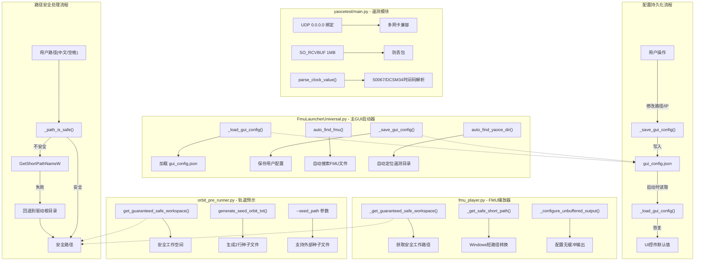

## 1. 高层摘要 (TL;DR)
FMU仿真平台路径兼容性与配置持久化升级
*   **影响:** 🟡 **中等** - 这是一次针对Windows路径兼容性和用户体验的重要升级,主要解决了中文路径、空格路径导致的FMU加载失败问题,并新增了配置持久化功能。
*   **核心变更:**
    1.  ✨ 新增GUI配置持久化机制,自动保存/恢复FMU路径、IP端口等设置
    2.  🔧 实现Windows路径安全处理(短路径/回退路径),解决中文路径和特殊字符问题
    3.  📡 优化UDP通信配置(控制端口改为8898,接收缓冲区增至1MB)
    4.  🛡️ 改进轨道预示模块的文件I/O兼容性,支持外部种子文件
    5.  🧹 简化打包配置,移除不必要的hiddenimports

---

## 2. 可视化概览 (代码与逻辑映射)



---

## 3. 详细变更分析

### 📦 组件一: 主GUI启动器 (`FmuLauncherUniversal.py`)

**变更内容:**
*   新增配置持久化系统,支持自动保存/恢复以下配置项:
    *   仿真FMU路径 (`sim_fmu`)
    *   轨道FMU路径 (`orbit_fmu`)
    *   遥测目录 (`yaoce_dir`)
    *   通信IP地址 (`ip`)
    *   通信端口 (`port`)

*   新增智能文件查找功能:
    *   `auto_find_fmu()` - 在`FMU/`目录和应用根目录自动搜索FMU文件
    *   `auto_find_yaoce_dir()` - 自动定位包含`config.ini`的遥测目录
    *   支持按名称和关键词搜索

*   改进环境变量处理:
    *   `_child_env()` - 设置`PYTHONUNBUFFERED`和`PYTHONIOENCODING`
    *   子进程启动时使用`bufsize=1`实现行缓冲

**配置数据结构:**

| 配置项 | 类型 | 默认值 | 说明 |
|--------|------|--------|------|
| `sim_fmu` | string | 自动查找 | 仿真FMU文件路径 |
| `orbit_fmu` | string | 自动查找 | 轨道预示FMU文件路径 |
| `yaoce_dir` | string | `APP_DIR/yaocetest` | 遥测配置目录 |
| `ip` | string | `127.0.0.1` | 远程通信IP地址 |
| `port` | int | `8889` | 远程通信端口 |

---

### 🔧 组件二: FMU播放器 (`fmu_player.py`)

**变更内容:**
*   **路径安全处理** - 解决Windows中文路径、空格、括号导致的C++文件I/O失败:
    *   `_path_is_safe()` - 检查路径是否符合ASCII、无空格、无括号
    *   `_get_safe_short_path()` - 使用Windows API获取8.3短路径
    *   `_get_guaranteed_safe_workspace()` - 短路径失败时回退到`驱动根目录\FmuWork{label}`

*   **无缓冲输出** - 确保日志实时输出:
    *   重构`print`函数,默认`flush=True`
    *   配置stdout/stderr的`line_buffering`和`write_through`

*   **通信端口调整**:
    *   控制端口从`8888`改为`8898` (避免与遥测端口冲突)

*   **文件路径覆盖优化**:
    *   FMU内部String参数只传递文件名(如`Orbit_Pre.txt`),不传递绝对路径
    *   因为已通过`os.chdir()`进入工作目录,避免路径中的特殊字符导致初始化挂起

---

### 🚀 组件三: 轨道预示运行器 (`orbit_pre_runner.py`)

**变更内容:**
*   **工作空间隔离**:
    *   使用UUID生成唯一工作目录: `fmu_orbit_work/job_{8位hex}`
    *   防止多次运行时的文件冲突

*   **路径安全处理**:
    *   与`fmu_player.py`相同的短路径/回退路径逻辑
    *   DLL加载前使用`get_safe_windows_path()`确保路径安全

*   **文件同步增强**:
    *   不仅同步DLL,还同步`.txt`, `.dat`, `.xml`, `.ini`, `.json`文件
    *   添加详细的同步日志

*   **种子文件改进**:
    *   `generate_seed_orbit_txt()` 生成**2行数据**而非1行
    *   第2行: JD+1,防止插值器崩溃
    *   新增`--seed_path`参数,支持外部种子文件

*   **初始化日志优化**:
    *   添加`enterInitializationMode`和`exitInitializationMode`的独立日志
    *   明确标注"这可能需要一段时间"

**种子文件格式变化:**

| 版本 | 行数 | 格式 | 说明 |
|------|------|------|------|
| 旧版 | 1行 | `double table(1,7)` | 可能导致插值器崩溃 |
| 新版 | 2行 | `double table(2,7)` | 第2行为JD+1,确保算法稳定 |

---

### 📡 组件四: 遥测模块 (`yaocetest/main.py`)

**变更内容:**
*   **UDP接收优化**:
    *   绑定到`0.0.0.0`而非空字符串,明确支持多网卡环境
    *   接收缓冲区设置为1MB (`SO_RCVBUF`),防止大数据包丢失

*   **时钟字段处理改进**:
    *   新增`parse_clock_value()`函数解析时间码格式: `天:时:分:秒:毫秒`
    *   仅对`S0067`和`DCSM34`字段进行时间码拆分
    *   避免误拆分`T0067`等普通测点(后缀相同但不是时间码)
    *   添加警告去重机制(`reported_warnings`)

*   **日志简化**:
    *   移除冗余的错误日志输出
    *   减少控制台RECV日志
    *   心跳提示信息简化

**时钟字段处理逻辑:**

| 字段名 | 格式 | 处理方式 | 输出字段 |
|--------|------|----------|----------|
| `S0067` | `1138:22:45:54:278` | 拆分为5个字段 | `A024`(天), `A025`(时), `A026`(分), `A027`(秒), `A028`(毫秒), `S0067`(总秒数) |
| `DCSM34` | `1138:22:45:54:278` | 同上 | 同上 |
| `T0067` | 任意值 | 不拆分 | `T0067`(原值) |

---

### 📦 组件五: 打包配置 (`FmuSolver.spec`)

**变更内容:**
*   清空`hiddenimports`列表,移除以下项:
    *   `yaocetest`
    *   `yaocetest.main`
    *   `yaocetest.packet_parser`
    *   `yaocetest.config_manager`

**原因:** 这些模块通过动态导入机制加载,不需要在spec中显式声明。

---

### 🔄 组件六: 工作进程入口 (`worker_entry.py`)

**变更内容:**
*   新增`--control_port`参数,默认值`8898`
*   将控制端口传递给`FMUPlayer`构造函数

---

## 4. 影响与风险评估

### ⚠️ 破坏性变更

| 变更项 | 旧值 | 新值 | 影响 |
|--------|------|------|------|
| 控制端口 | `8888` | `8898` | 需要更新外部控制脚本的端口配置 |
| UDP绑定地址 | `''` | `0.0.0.0` | 行为一致,但更明确 |
| 种子文件行数 | 1行 | 2行 | 向后兼容,不影响现有种子文件 |

### ✅ 向后兼容性
*   ✅ 配置文件`gui_config.json`不存在时使用默认值
*   ✅ 短路径失败时自动回退到安全路径
*   ✅ 外部种子文件参数可选,默认从参数生成

### 🧪 测试建议

1.  **路径兼容性测试**:
    *   在中文用户名目录下运行(如`C:\Users\木木\...`)
    *   在包含空格的路径下运行(如`C:\Program Files (x86)\...`)
    *   在禁用8.3短路径的企业系统上运行

2.  **配置持久化测试**:
    *   修改FMU路径后重启程序,验证是否恢复
    *   修改IP端口后重启,验证是否保存

3.  **通信测试**:
    *   验证控制端口8898是否正常工作
    *   测试多网卡环境下的UDP接收

4.  **轨道预示测试**:
    *   使用外部种子文件运行
    *   验证生成的种子文件为2行格式

5.  **遥测模块测试**:
    *   发送`S0067`时间码格式数据,验证拆分正确
    *   发送`T0067`普通数据,验证不被误拆分

---

## 5. 关键代码片段

### 路径安全处理核心逻辑
```python
def _get_guaranteed_safe_workspace(label, root_dir):
    candidate = os.path.join(root_dir, f"fmu_work_{label}")
    os.makedirs(candidate, exist_ok=True)
    short = _get_safe_short_path(candidate)
    if _path_is_safe(short):
        return short
    # Fallback: use drive root
    drive = os.path.splitdrive(root_dir)[0] or 'C:'
    fallback = os.path.join(drive + os.sep, f'FmuWork{label}')
    os.makedirs(fallback, exist_ok=True)
    return fallback
```

### 时钟字段解析
```python
def parse_clock_value(clock_str):
    parts = [p.strip() for p in clock_str.split(":")]
    if len(parts) < 5:
        return None
    day, hour, minute, second, millisecond = map(int, parts)
    total_seconds = day*86400.0 + hour*3600.0 + minute*60.0 + second + millisecond/1000.0
    return {"A024": day, "A025": hour, "A026": minute, "A027": second, "A028": millisecond, "total": total_seconds}
```

### 配置持久化
```python
def _save_gui_config(self):
    data = {
        "sim_fmu": self.fmu_path_var.get().strip(),
        "orbit_fmu": self.orbit_fmu_path_var.get().strip(),
        "yaoce_dir": os.path.normpath(self.yaoce_dir),
        "ip": self.ip_var.get().strip(),
        "port": int(self.port_var.get()),
    }
    with open(self.gui_config_path, 'w', encoding='utf-8') as f:
        json.dump(data, f, indent=2, ensure_ascii=False)
```

---

**总结:** 本次更新显著提升了FMU仿真平台在Windows环境下的兼容性和用户体验,特别是解决了中文路径和特殊字符路径导致的运行时问题。配置持久化功能减少了重复配置的工作量,而路径安全处理机制确保了在各种企业环境下的稳定运行。